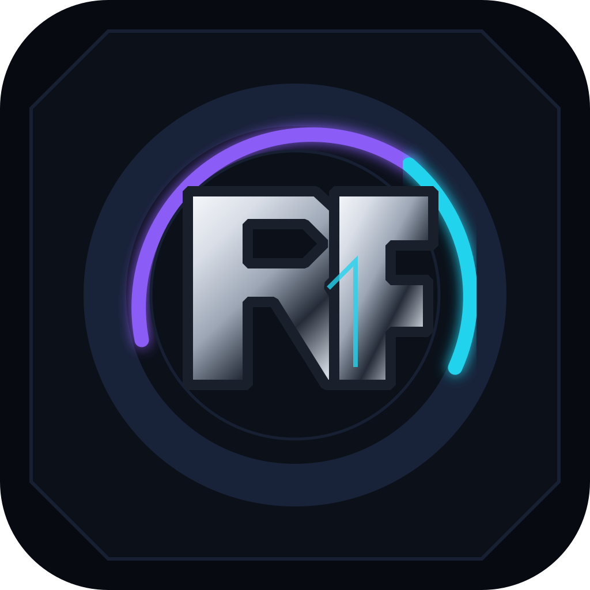
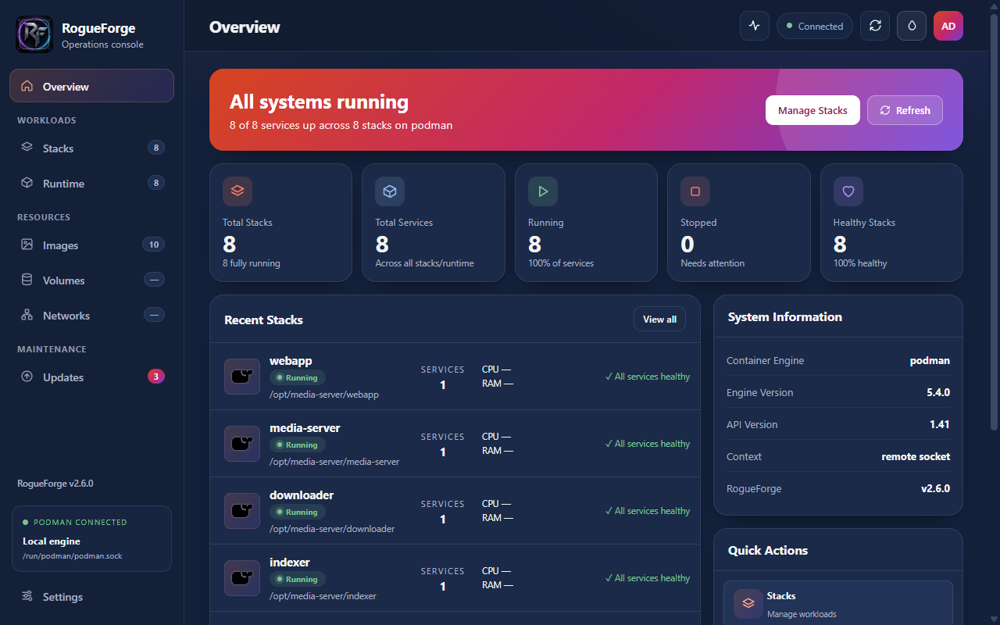
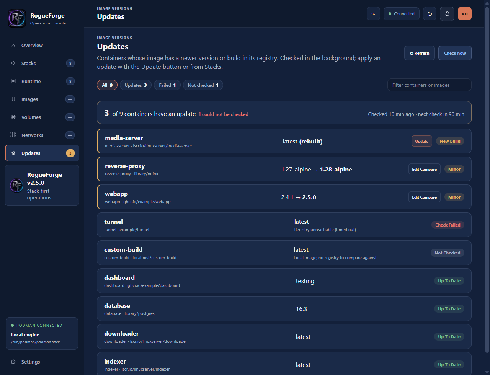
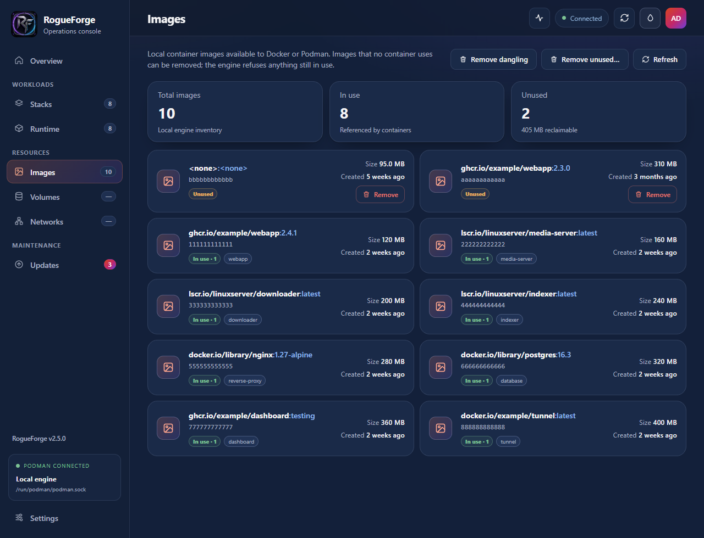

<div align="center">



# RogueForge

**Local-first Docker and Podman stack management, verified updates and live troubleshooting.**

[](https://github.com/RogueAssassin/RogueForge/tree/main)
[](https://github.com/RogueAssassin/RogueForge/actions/workflows/container.yml?query=branch%3Amain)


</div>

RogueForge is the management and troubleshooting layer for the Rogue media-server stack. It discovers Compose projects, safely controls stacks and containers, performs verified image updates, streams logs on demand, provides authenticated terminal access, edits Compose/.env files transactionally and exposes lightweight runtime inventory.

RogueForge deliberately stays separate from **RogueDashboard**, which owns monitoring, uptime, incidents and notifications, and **RogueMediaValidator**, which owns torrent/media validation and protection.

## Highlights

- verified Start, Stop, Restart, Recreate and Update workflows
- per-stack lifecycle serialization to prevent competing actions
- in-place updates with immutable image verification and rollback
- bounded Activity history with timeout, cancellation, progress, export, Clear all and Trim
- on-demand live logs with search, severity filtering, pause/resume and download
- authenticated per-container terminal access
- Images, Volumes and Networks inventory
- built-in **Updates** page that shows which containers have a newer image available, with an Update button
- remove unused images and volumes from their pages, with server-side safety checks
- transactional Compose and `.env` editing with validation and backup
- Docker and rootless Podman support
- short-lived inventory/dashboard caches and bounded engine concurrency
- canonical deployment under `/opt/media-server/rogueforge`
- no permanent log indexer and no high-frequency background engine polling

## What's new in 2.6.0

- a new interface: one SVG icon set, a grouped sidebar, a status banner on the Overview and restyled cards, buttons and dialogs
- compact icon actions on the Runtime page, which becomes stacked cards on phones
- fixed the Runtime **Ports** column showing `undefined/tcp`

## What's new in 2.5.0

- **Clean up unused images and volumes** from the Images and Volumes pages: per-item **Remove**, **Remove dangling** and **Remove unused…**, with a confirmation that lists what will be removed (volumes need a typed confirmation)
- a better Updates page: filter chips, search, next-check time and an **Update** button

See [Cleaning up images and volumes](#cleaning-up-images-and-volumes).

## What's new in 2.4.2

- new **Updates** page: see which of your containers have a newer image in their registry, without leaving RogueForge
- versioned tags are reported as major, minor or patch updates; moving tags such as `latest` and `testing` are compared by digest
- an alert count in the sidebar, a background check every 6 hours and a **Check now** button
- built in: no extra container, no extra socket mount, anonymous reads only, and it never pulls or changes anything
- the same on Docker and rootless Podman
- four optional settings (`ROGUEFORGE_UPDATES`, `ROGUEFORGE_UPDATE_INTERVAL`, `ROGUEFORGE_UPDATE_TIMEOUT`, `ROGUEFORGE_UPDATE_CONCURRENCY`); existing `.env` files keep working without them

## What's new in 2.4

RogueForge 2.4 builds on the 2.x stable operations platform (API v2, unchanged persistent state).

- clean Rogue navy look with Default, Light, Dark and System themes, shared with RogueDashboard and RogueMediaValidator
- tidier Activity drawer: finished operations fold their output, and **Clear all** or **Trim** (keep the last 5, 10 or 25) tidy the history; running operations are never removed
- history is capped at 50 finished operations by default (`ROGUEFORGE_OPERATIONS_KEEP`, 5-500)
- Podman `update.sh` no longer refuses updates after the first run
- bundled podman-compose 1.6.0 and Docker CLI 29.9.3

See the [changelog](CHANGELOG.md) for the full list.

## Screenshots

The screenshots use sample data.

**Overview**



**Updates**



## Rogue ecosystem

| Service | What it does |
| --- | --- |
| [**RogueDashboard**](https://github.com/RogueAssassin/RogueDashboard) | Lightweight media-server visibility, health, uptime, incidents, alerts and service overview. |
| **RogueForge** | Docker/Podman stack management, verified updates, live logs, terminals and operational troubleshooting. |
| [**RogueMediaValidator**](https://github.com/RogueAssassin/RogueMediaValidator) | Torrent/media validation and protection for download workflows, including policy enforcement and diagnostics. |
| [**RogueRoute-GPX**](https://github.com/RogueAssassin/RogueRoute-GPX) | Routing and GPX services for route generation, processing and related mapping workflows. |

RogueDashboard can consume RogueForge's lightweight status information without receiving Docker/Podman socket access or RogueForge administrator credentials.

## Default layout

```text
/opt/media-server/
├── rogueforge/
│   ├── compose.yaml
│   ├── .env
│   ├── update.sh
│   ├── setup-auth.py
│   └── data/
│       ├── auth.json
│       └── operations.json
├── radarr/
├── sonarr/
├── bazarr/
├── qbittorrent/
├── roguedashboard/
└── ...
```

RogueForge's own deployment stays in `/opt/media-server/rogueforge`. Stack discovery remains rooted at `/opt/media-server` so sibling Compose projects remain visible.

## Quick install — Podman

```bash
mkdir -p /opt/media-server/rogueforge
cd /opt/media-server/rogueforge

curl -fsSL https://raw.githubusercontent.com/RogueAssassin/RogueForge/main/compose.yaml -o compose.yaml
curl -fsSL https://raw.githubusercontent.com/RogueAssassin/RogueForge/main/.env.example -o .env
curl -fsSL https://raw.githubusercontent.com/RogueAssassin/RogueForge/main/setup-auth.py -o setup-auth.py
chmod 600 .env

# Set ROGUEFORGE_SOCKET_SOURCE to /run/user/$(id -u)/podman/podman.sock
nano .env
python3 setup-auth.py --username administrator

podman network inspect media-net >/dev/null 2>&1 || podman network create media-net
podman compose --env-file .env -f compose.yaml pull
podman compose --env-file .env -f compose.yaml up -d
```

Open:

```text
http://HOST:17810
```

## Quick install — Docker

```bash
mkdir -p /opt/media-server/rogueforge
cd /opt/media-server/rogueforge

curl -fsSL https://raw.githubusercontent.com/RogueAssassin/RogueForge/main/compose.yaml -o compose.yaml
curl -fsSL https://raw.githubusercontent.com/RogueAssassin/RogueForge/main/.env.example -o .env
curl -fsSL https://raw.githubusercontent.com/RogueAssassin/RogueForge/main/setup-auth.py -o setup-auth.py
chmod 600 .env
```

Set the Docker socket values documented in `.env`, create authentication, then start with:

```bash
docker network inspect media-net >/dev/null 2>&1 || docker network create media-net
docker compose --env-file .env -f compose.yaml pull
docker compose --env-file .env -f compose.yaml up -d
```

## Updating

Production:

```bash
cd /opt/media-server/rogueforge
./update.sh latest
```

Pinned version:

```bash
./update.sh 2.6.1
```

Testing channel:

```bash
./update.sh testing
```

The updater preserves the existing `.env` and persistent authentication/operation data.

## Performance defaults

```env
ROGUEFORGE_DISCOVERY_CACHE=10
ROGUEFORGE_INVENTORY_CACHE=2
ROGUEFORGE_DASHBOARD_CACHE=3
ROGUEFORGE_DASHBOARD_STALE=30
ROGUEFORGE_RESOURCE_CACHE=15
ROGUEFORGE_ENGINE_DETAIL_CONCURRENCY=4
ROGUEFORGE_MAX_LOG_STREAMS=6
ROGUEFORGE_LOG_TAIL=200
```

The supplied `.env.example` documents every deployment, lifecycle, performance, logging and terminal setting.

## Themes

The theme button at the top right switches between **Default** (Rogue navy), **Light**, **Dark** and **System** (follows the device's light or dark setting). The choice is saved per browser. RogueDashboard, RogueForge and RogueMediaValidator share the same menu and palette, with one warm clay accent.

## Persistent files

Keep these between upgrades:

```text
.env
data/auth.json
data/operations.json
```

## Update checker


The **Updates** page shows which containers have a newer image available. RogueForge checks each
image against its registry in the background (every 6 hours by default, or on **Check now**):

- versioned tags (`2.4.1`, `1.27-alpine`) are compared with the registry tag list and reported as
  major, minor or patch updates, so a new RogueForge release appears here too;
- moving tags (`latest`, `testing`) are compared by digest and reported as a new build.

It uses anonymous HTTPS reads only and never pulls or changes anything; apply updates from Stacks or
Runtime as usual. It works the same on Docker and rootless Podman because it needs only the engine
access RogueForge already has. Private images are shown as "not checked". Tune or disable it with the
`ROGUEFORGE_UPDATE*` settings in `.env.example`.

| Badge | Meaning |
| --- | --- |
| Up to date | The registry has nothing newer than what the container runs. |
| Major / Minor / Patch | A newer version tag exists (for example `2.4.1` → `2.5.0`). |
| New build | A moving tag such as `latest` now points at a newer image. |
| Check failed | The registry could not be reached or answered with an error; hover for the reason. |
| Not checked | Local images (`localhost/…`), digest-pinned references and registries that need a login. |

The container needs outbound HTTPS to the registries your images use (for example `docker.io` and `ghcr.io`). The sidebar count shows how many containers have an update. See
[docs/CONTAINER_DEPLOYMENT.md](docs/CONTAINER_DEPLOYMENT.md#update-checker).

## Cleaning up images and volumes



Old images and volumes pile up as stacks are updated. The **Images** and **Volumes** pages show which ones no container uses and let you remove them:

- **Remove** on an unused image or volume removes just that item.
- **Remove dangling** (Images) removes untagged leftovers that no container uses; this is the safe everyday cleanup.
- **Remove unused…** removes every image, or every volume, that no container uses. A confirmation lists exactly what will go.
- Volumes hold data, so deleting them is permanent and asks you to type `DELETE` (or the volume's name). A volume can look unused when its stack was taken down but you still want the data; check the list before confirming.

Safety: RogueForge re-reads the inventory for every request and skips anything that a container (running or stopped) uses. The engine is never forced, so it refuses anything still referenced. All cleanup endpoints are administrator only and CSRF protected.

## Security model

RogueForge:

- requires local administrator authentication for protected operations
- uses signed sessions, CSRF protection and login throttling
- protects its own stack from in-app lifecycle actions
- limits terminal and live-log concurrency
- validates stack configuration before saving
- stores backups outside the Compose discovery tree
- requires intentional Docker/Podman socket access because engine management is its purpose

Keep RogueForge behind a trusted reverse proxy and do not expose the engine socket beyond the RogueForge container.

## Documentation

- [Installation](docs/INSTALL.md)
- [Container deployment](docs/CONTAINER_DEPLOYMENT.md)
- [GHCR publishing](docs/GHCR.md)
- [Security](SECURITY.md)
- [Roadmap](MILESTONES.md)
- [Changelog](CHANGELOG.md)

## Release channels

Production:

```text
ghcr.io/rogueassassin/rogueforge:latest
ghcr.io/rogueassassin/rogueforge:2.6.1
```

Testing:

```text
ghcr.io/rogueassassin/rogueforge:testing
```

`main` is the stable production branch. The permanent `testing` branch is the proving ground for the next release.
